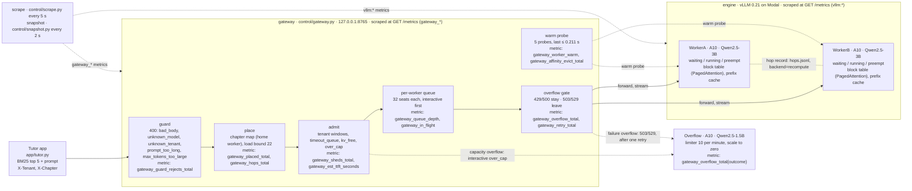

# Tutor: an inference cluster with its own control plane

Maven Inference Engineering final project. A **tutor app** answers questions about the course's revision notes (RAG, Track A). It runs on **two vLLM workers on Modal** (Qwen2.5-3B-Instruct on one A10 each). A **gateway** on the laptop decides what enters, where it goes and what leaves: guard, admit, place, queue, hop, warm and overflow.

The full design, the numbers behind every constant, and the proof runs are in **[DESIGN.md](DESIGN.md)**. The analysis notebook is **[notebook/analysis.ipynb](notebook/analysis.ipynb)**.

## Architecture



One line per box: the file that implements it, and the metric it emits.

- **gateway** (`control/gateway.py`): the request path and `GET /metrics`; every request is a row in `gateway_requests.jsonl`.
  - **guard** (`control/guard.py`): `gateway_guard_rejects_total{reason}`.
  - **place** (`control/place.py`): `gateway_placed_total{worker}`, `gateway_hops_total{src,dst}`.
  - **admit** (`control/admit.py`, estimate from `control/snapshot.py`): `gateway_sheds_total{reason}`, `gateway_est_ttft_seconds{worker}`, `gateway_tenant_tokens_60s{tenant}`.
  - **per-worker queue** (`control/queue.py`): `gateway_queue_depth{worker}`, `gateway_in_flight{worker}`, `gateway_aborts_total{stage}`.
  - **overflow gate** (`control/overflow.py`): `gateway_overflow_total{reason,outcome}`, `gateway_retry_total{src,dst}`.
  - **warm probe** (`cluster/warm.py`, evict in `control/evict.py`): `gateway_worker_warm{worker}`, `gateway_affinity_evict_total`.
- **engine** (`cluster/modal_vllm.py`, WorkerA and WorkerB): `vllm:num_requests_waiting`, `vllm:num_requests_running`, `vllm:num_preemptions_total`, `vllm:kv_cache_usage_perc`, `vllm:prefix_cache_hits_total`, `vllm:time_to_first_token_seconds`.
- **Overflow** (`cluster/modal_vllm.py`, server `Overflow`): counted at the gateway, `gateway_overflow_total{reason,outcome}`; the requests carry `X-Via: overflow:qwen2.5-1.5b`.
- **hop record** (dashed, `control/hop.py`): `metrics/<run>/hops.jsonl` and `metrics/hops.json`; nothing is copied, the destination recomputes the prefix.
- **scrape** (`control/scrape.py`): `metrics/<run>/scrape_<run>.jsonl`, workers and gateway every 5 s.

What each part decides:

| Box | Code | What it decides |
|---|---|---|
| App | `app/` | retrieve 5 chunks (BM25), build the prompt, send `X-Tenant` and `X-Chapter` |
| Guard | `control/guard.py` | 400 for a bad body, an unknown model, an unknown tenant, a prompt that is too long, or too many answer tokens |
| Place | `control/place.py` | the chapter's home worker, unless it is busy or not warm (then a hop) |
| Admit | `control/admit.py` | 429 for `tenant_tokens`, `timeout_queue`, `kv_free`, `over_cap`; interactive `over_cap` may overflow |
| Queue | `control/queue.py` | 32 seats per worker; request 33 waits here, interactive first |
| Hop | `control/hop.py` | a record of every request placed away from home (the prefix is recomputed) |
| Warm | `cluster/warm.py` | a worker takes traffic only after 5 probes show it is warm |
| Overflow | `control/overflow.py` | 429/500/out-of-memory stay; 503/529 and capacity overflow leave to the 1.5B model |
| Engine | `cluster/modal_vllm.py` | vLLM 0.21.0: prefix caching, chunked prefill, 32 decode slots, 8,192 tokens per sequence |

## How to run it

From the repo root, Python 3.10:

```bash
# 0. Laptop tools (pinned)
uv venv --python 3.10 && source .venv/bin/activate && uv pip install -r requirements.txt
modal setup                                   # once per laptop

# 1. Corpus and chunks (the PDFs are not in git: put them in corpus/, see corpus/manifest.json)
python -m app.ingest

# 2. Start the cluster: WorkerA, WorkerB (always on) and Overflow (from zero)
modal deploy cluster/modal_vllm.py            # about 2 to 3 minutes until healthy
python cluster/write_workers.py               # writes cluster/workers.json and cluster/overflow.json

# 3. One question through the gateway
python -m control.gateway &                   # 127.0.0.1:8765; waits until both workers are warm
python -m app.tutor "Why does prefix caching save prefill time?" --base-url http://127.0.0.1:8765

# 4. A load run: gateway + scrape + traffic, all logs in metrics/<run>/
RUN=run_x MIXES=mixed USERS=96 DURATION=240 bash traffic/gateway_run.sh
python metrics/summarise_run.py metrics/run_x
python plots/make_plots.py --run-dir metrics/run_x --out-dir plots/run_x --label "run X"

# 5. Cross-run analysis
python metrics/goodput.py                     # metrics/goodput.json, plots/goodput_vs_offered.png
python metrics/whatif.py                      # metrics/whatif.json (first-order replay)
python metrics/compare_runs.py --base run_i --new run_j --also run_m run_m2   # metrics/run_j/compare_run_i.json
python -m traffic.run_l guard --out-dir metrics/run_l_guard   # run L, with the gateway running (see DESIGN Part 7)
pytest tests/                                 # guard, admit, place, queue, overflow
jupyter lab notebook/analysis.ipynb

# 6. Stop billing (both A10s bill while deployed)
modal app stop tutor-cluster
```

Settings for `traffic/gateway_run.sh`: `RUN`, `MIXES` (`unique`, `shared_chapter`, `mixed`), `CHAPTER`, `USERS`, `DURATION`, `PLACE_POLICY` (`prefix_then_load`, `least_loaded`, `p2c`), `LOAD_BOUND`, `MAX_IN_FLIGHT`, `TENANT_SCALE`, `OVER_CAP_TTFT` (default 2 s), `BASE_TTFT` (default 0.4 s), `WARM_TTFT` (default 0.211 s), `INTERACTIVE_DEADLINE` (default 6 s). The gateway writes the active admit settings to `admit_settings.json` in the run folder. Engine profiles for KV-pressure tests: `ENGINE_PROFILE=pressure` or `pressure2` before `modal deploy`.

## Where each run's data is

Each folder in `metrics/` holds the traffic log (`traffic_*.jsonl`, one row per client request), the scrape (`scrape_*.jsonl`, workers and gateway every 5 s), and for gateway runs the gateway log (`gateway_requests.jsonl`), hops (`hops.jsonl`), warm checks (`warm_events.jsonl`) and `summary.json`. Plots are in `plots/<run>/`.

| Run | Folder | What it tested |
|---|---|---|
| A | `metrics/baseline_a/` | 8 users, 3 mixes, straight to WorkerA: no queue |
| B | `metrics/baseline_b/` | 48 users, 3 mixes, straight to WorkerA: over the 32 slots |
| C | `metrics/run_c/` | Step 4 gateway: guard and admit, one worker |
| D | `metrics/run_d/` | Steps 5 to 8: placement and hops, 3 mixes, 48 users |
| E | `metrics/run_e/` | WorkerB cold start: warm proof and hops |
| F | `metrics/run_f/` | pressure engine (0.5 memory, 64 seats), 64 users |
| G | `metrics/run_g/` | 96 users after the fixes: the gateway queue |
| F2 | `metrics/run_f2/` | pressure2 engine (0.4 memory), 128 users: `kv_free` and preemptions |
| H1, H2 | `metrics/run_h1/`, `metrics/run_h2/` | `least_loaded` vs `prefix_then_load`: does prefix routing help? |
| I | `metrics/run_i/` | 96 users with capacity overflow to the 1.5B model |
| J | `metrics/run_j/` | run I's load with `over_cap` trigger 4 s, tenant windows ×2, no 0.4 s floor |
| L | `metrics/run_l_guard/`, `metrics/run_l_abort/` | 12 guard deaths (0 engine calls); 10 of 20 clients close at 1.0 s |
| M, M2 | `metrics/run_m/`, `metrics/run_m2/` | interactive deadline 3 s at 64 and 96 users: `timeout_queue` vs late answers |

The addendum's "Run J: guard deaths and client abort" is run L here, and its "Run K" is runs M and M2: run J was already the three-decision run.

Every run folder holds its scrape (`scrape_*.jsonl`), except `run_l_guard/`: its 12 requests take 0.1 s, so `summary.json` records each worker's vLLM counters before and after instead. Run L's abort part scrapes every 1 s (`scrape_1s.jsonl`).

Cross-run files: `metrics/counts.md` (200, 429 by reason, 503, 400 and aborted per run; no run had a 503), `metrics/stories.md` (one real request per exit), `metrics/hops.json`, `metrics/evict_count.txt`.

Other files in `metrics/`: `gpu_facts.json` and `worker_startup_log.txt` (Part 1), `warm_proof.json`, `overflow_check.json`, `network_offset.json`, `goodput.json`, `whatif.json`, `metric_names.txt`.

## Layout

| Folder | What is in it |
|---|---|
| [`app/`](app/) | the tutor: ingest, BM25 retrieve, prompt, CLI |
| [`control/`](control/) | the gateway: guard, admit, place, queue, hop, evict, overflow, snapshot, scrape |
| [`cluster/`](cluster/) | the engine on Modal (`modal_vllm.py`), warm checks, cold start, probes |
| [`DESIGN.md`](DESIGN.md) | the design, Parts 1 to 8 |
| [`plots/`](plots/) | the eight dashboards `01_cluster` to `08_pods`, plus plots per run in `plots/<run>/` |
| [`metrics/`](metrics/) | scrapes and logs per run, `hops.json`, `evict_count.txt`, `counts.md`, `stories.md`, goodput, what-if |
| [`notebook/`](notebook/) | `analysis.ipynb`, in the dashboard order; one cell per Part 5 question |
| [`traffic/`](traffic/) | load generator (3 mixes), run scripts, `run_l.py` |
| [`tests/`](tests/) | pytest: guard, admit, place, queue, overflow, evict |

## Cost

WorkerA and WorkerB keep one A10 each while deployed: about $2.20 per hour for the GPUs, $2.35 to $2.85 with CPU and memory. Overflow costs nothing until a request reaches it, and stops 5 minutes after the last one. Stop everything with `modal app stop tutor-cluster`.
